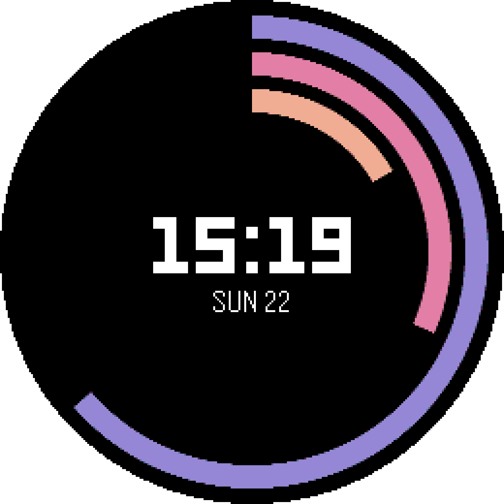
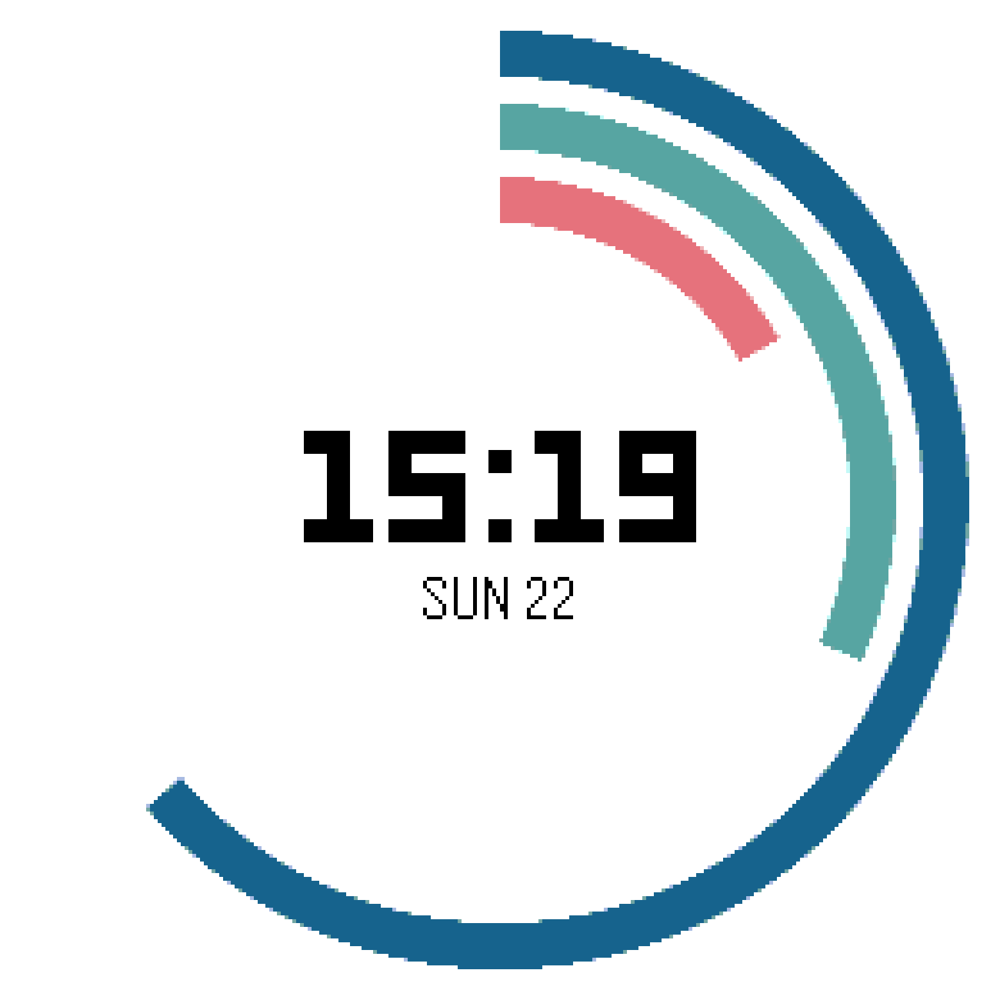

# Orbit

A watchface for Pebble Round 2. Digital time in the center, three rings around it.

- **Outer ring** — hours
- **Middle ring** — minutes
- **Inner ring** — seconds

The hour ring fills over 12 hours or 24 hours, matching the watch’s time format.

Tap the gear next to Orbit in the Pebble app to change colors, how often the seconds ring updates, and whether the face sleeps when idle.

## Install

Download [orbit.pbw](https://github.com/bartrikers6224/Pebble-Orbit/raw/main/orbit.pbw), send it to your phone, and open it with the Pebble app while the watch is connected.

- **iPhone:** Files, Mail, or AirDrop → tap the file → open in **Pebble**. If it saves as a `.zip`, rename it to `.pbw` first.
- **Android:** Downloads → tap the file → open with **Pebble**. If Pebble is not listed, install [Sideload Helper](https://help.rebble.io/sideloading/) first.

Then start Orbit from **Apps → Watchfaces**.

## Settings

**Update every** — 1 second, 10 seconds, 30 seconds, or Adaptive. Adaptive runs every second while the backlight is on, and for a few seconds after you flick your wrist to look. The rest of the time it updates every 10 seconds, which uses less battery.

**Sleep when idle** — blacks the screen while charging, or after about five minutes with no motion, so a frozen time is not mistaken for the current time. Unplugging wakes it. Shake or tap to wake after idle sleep.

## Looks

| Midnight | Dusk | Paper |
| --- | --- | --- |
|  |  |  |
