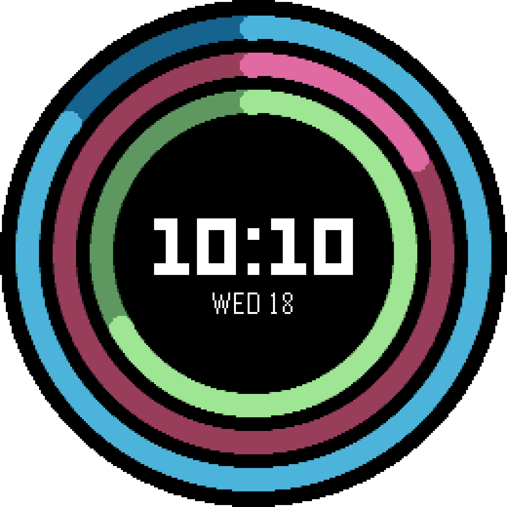

# Orbit

A Pebble Round 2 watchface: large digital time in the center, three concentric rings around it.



- **Outer ring** — hours (12-hour sweep, including minutes)
- **Middle ring** — minutes
- **Inner ring** — seconds, stepping every 10 seconds so the watch is not woken every tick

Tap the gear next to Orbit in the Pebble app to set background, time, and each ring color on their own.

Built for **Pebble Round 2** (`gabbro`) on Pebble SDK 4.44.

## Install on your watch

1. Build, or use the already-built `build/orbit.pbw`.
2. Open the Pebble mobile app, sign in, and enable **Dev Connection** on your Round 2 (Devices → ⋮ → Dev Connection).
3. From this project:

```bash
pebble login
pebble install --cloudpebble
```

You can also drop `build/orbit.pbw` onto the watch from the Pebble app’s sideload / open-with flow.

## Build locally

You need the [Pebble SDK](https://developer.repebble.com/sdk) (`pebble-tool` 5.1+ and SDK 4.44).

```bash
pebble sdk install latest
pebble build
pebble install --emulator gabbro
```

On a machine without a display, add `--vnc` to emulator commands.

Open the settings page against the emulator with:

```bash
pebble emu-app-config --emulator gabbro
```

## Battery

Time digits and the hour/minute rings update once a minute. The seconds ring is driven by an `AppTimer` aligned to 10-second boundaries (`:00`, `:10`, `:20`, `:30`, `:40`, `:50`). There is no per-second tick subscription.
